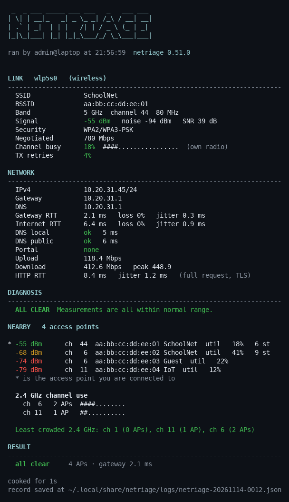
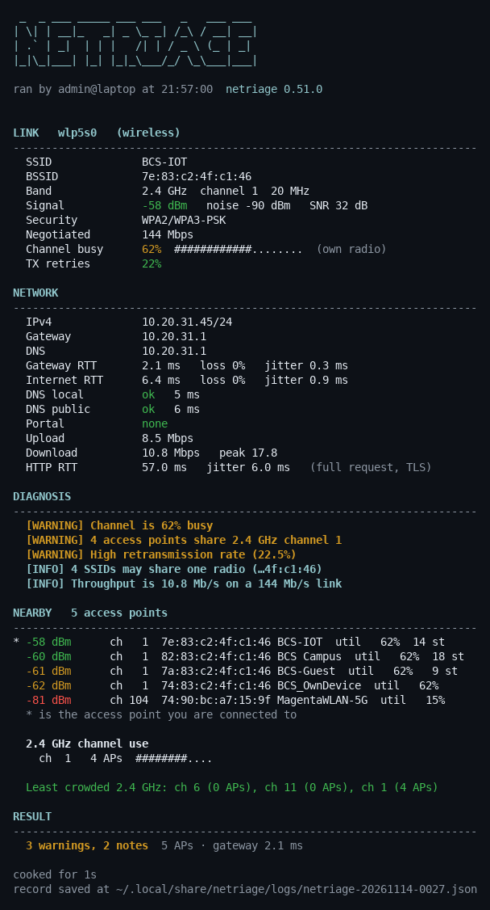
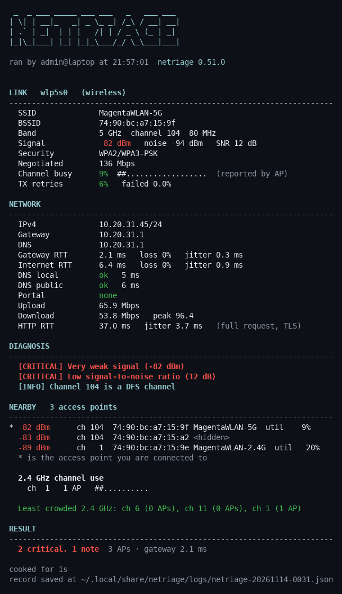

# netriage — command guide

## Commands

| Command | Question it answers |
|---|---|
| `netriage` | What is wrong with this link, right now? |
| `netriage scan` | What is around me, and how busy are the channels? |
| `netriage watch` | Is the fault intermittent? When does it drop? |
| `netriage read ID` | What did that run look like? |
| `netriage report [FILE \| ID]` | The same run as Markdown, for a ticket. |
| `netriage compare [A] [B]` | Did the change actually help? |
| `netriage history` | The saved runs, numbered. |

### `netriage`

One pass: link, network, throughput, verdict. About 5–20 seconds.

```bash
netriage                      # what is wrong right now
netriage --wired              # force the cable
netriage --offline            # never touch the internet, ~2 seconds
```

### `netriage scan`

```bash
netriage scan
netriage scan --json | jq '.[] | {ssid, channel, signal}'
```

Merges `iw` and `nmcli`, deduplicated by BSSID: one source alone often reports
less. As root you also get each access point's own load and client count;
without it the table says so.

### `netriage watch`

```bash
netriage watch --minutes 20 --interval 2
```

| Option | Default |
|---|---|
| `--minutes M` | 10 |
| `--interval S` | 5 |
| `--out FILE` | `~/Documents/netriage-log/watch-*.csv` |

One CSV row per sample, plus a summary when it stops.

### `netriage read ID`

Re-prints a saved run in the shape of a live one. No hardware, no root.

```bash
netriage history        # the id is the first column
netriage read 12
```

### `netriage report [FILE | ID]`

Markdown for one run; the newest by default. Missing values read `unknown` or
`not tested`, never `0`.

### `netriage compare [A] [B] ...`

```bash
netriage compare                    # the two most recent
netriage compare 23 22              # by run id
netriage compare a.json b.json      # by file
netriage compare 1 2 3 4            # trend table
```

Two runs from different media are refused: they share no measurement.

## Flags

Options work before or after the command.

| Flag | Effect |
|---|---|
| `--iface NAME` | test a specific interface |
| `--wired` / `--wifi` | force the medium |
| `--offline` | no speed test, no public DNS, no portal check |
| `--json` | machine-readable output — the default run and `scan` only |
| `--data-dir PATH` | where reports go; absolute, remembered; `default` forgets |
| `--redact` | mask MACs, addresses, SSIDs, user name, and the debug bundle |
| `--version` | version and where the package was loaded from |

`NO_COLOR` disables colour. Exit codes: `0` fine, `1` a CRITICAL finding, `2`
could not run, `130` interrupted.

## One run, start to finish


As a normal user you get the link, the network, the throughput and the verdict.
Two lines say what root would add: the radio's own channel load, and each
access point's load and client count.


With `sudo` those two lines fill in and nothing else changes.

## Three results

### A healthy link

```
  all clear     4 APs · gateway 2.1 ms
```



Signal above −60 dBm, retries under 10%, channel not crowded. Nothing to do.

### A crowded channel



```
  [WARNING] Channel is 62% busy
  [WARNING] 4 access points share 2.4 GHz channel 1
  [WARNING] High retransmission rate (22.5%)
  [INFO] Throughput is 10.8 Mb/s on a 144 Mb/s link
```

Signal is fine. The air is the problem. The last line matters most: the radio
negotiated 144 Mb/s but delivered 10.8, so whatever is limiting it is not the
signal strength.

### A weak signal



```
  [CRITICAL] Very weak signal (-82 dBm)
  [CRITICAL] Low signal-to-noise ratio (12 dB)
  [INFO] Channel 104 is a DFS channel
```

−82 dBm at 5 GHz. The channel is only 9% busy and retries are low, so this is
distance, not interference.

## Reading the numbers

### Wireless link

| Field | Good | Watch | Bad | What it is |
|---|---|---|---|---|
| Signal | ≥ −60 dBm | ≤ −70 → WARNING | ≤ −78 → CRITICAL | distance and walls |
| SNR | ≥ 25 dB | 15–25 | < 15 → CRITICAL | signal above the noise floor |
| Channel busy | < 30% | ≥ 50% → WARNING | ≥ 70% → CRITICAL | airtime already used |
| TX retries | < 10% | ≥ 20% → WARNING | ≥ 35% → CRITICAL | the real health meter |
| Negotiated | — | — | — | what the radios agreed on, not what you get |

### Network

| Field | Good | Watch | Bad |
|---|---|---|---|
| Gateway RTT | < 10 ms | ≥ 100 ms → WARNING | ≥ 300 ms → CRITICAL |
| Gateway loss | 0% | — | ≥ 20% → CRITICAL |
| Internet loss | 0% | ≥ 5% → WARNING | — |
| Jitter | < 5 ms | ≥ 20 ms and ≥ 50% of the mean | — |
| DNS (local) | ok, < 50 ms | > 200 ms → WARNING | no reply → CRITICAL |
| HTTP RTT | < 100 ms | — | — |
| Subnet | /24 | ≤ /16 → WARNING | — |

`DNS local` is the resolver DHCP handed out; `DNS public` is 1.1.1.1, there for
comparison. REFUSED, SERVFAIL and NXDOMAIN are reported as themselves, not as
"the server is down".

`HTTP RTT` is a full request over TLS: DNS, TCP, the handshake and a few
bytes back. Three destinations are configured and the first that answers is
used, so a site that is blocked on this network costs one attempt instead of
turning into a false fault. Which one was used is not reported, because the
number describes this network, not that server.

### Wired link

| Field | Good | Bad | What it is |
|---|---|---|---|
| Speed / duplex | 1000 Mb/s full | — | half duplex deserves a look |
| Frame errors | < 10 per million | ≥ 10 → WARNING, ≥ 100 → CRITICAL | a rate, not a count |
| Checksum errors | any | — | not frame errors: the adapter's own tally |
| LLDP | switch + port | unknown | which port you are plugged into |

### `unknown`

A value that could not be read says `unknown`, never `0`. A missing tool is not
a healthy link.

## Recipes

**Site survey**

```bash
for room in 101 102 201; do echo "== $room"; netriage scan | head -20; done
```

**Before and after a change**

```bash
netriage --json > before.json
# change the channel
netriage --json > after.json
netriage compare before.json after.json
```

**A fault that comes and goes**

```bash
netriage watch --minutes 30 --interval 2
# look for DISCONNECTED rows and the Drops count
```

**Evidence for a ticket**

```bash
netriage
netriage report > evidence.md
```

## Install, upgrade, remove

Two ways in. Both end with `netriage` and `sudo netriage` in `/usr/local/bin`,
with every feature. Only maintenance differs.

### With pipx

```bash
pipx install netriage
sudo ln -sf "$(command -v netriage)" /usr/local/bin/netriage
```

The link is what makes `sudo netriage` work: pipx installs to `~/.local/bin`,
and sudo does not look there. Run the two in that order — `command -v` needs
the first one to have finished.

| Action | Command |
|---|---|
| Upgrade | `pipx upgrade netriage` |
| Remove | `pipx uninstall netriage && sudo rm /usr/local/bin/netriage` |
| See what is installed | `pipx list` |
| Version in use | `netriage --version` |

### Without pipx

```bash
git clone https://github.com/chchenbo/netriage netriage-src
cd netriage-src && sudo bash install.sh
```

| Action | Command |
|---|---|
| Upgrade | `cd netriage-src && git pull && sudo bash install.sh` |
| Remove | `cd netriage-src && sudo bash uninstall.sh` |
| Version in use | `netriage --version` |

No network at install time, no pip, no virtualenv: it copies the package into
`/usr/local/lib/pythonX.Y/dist-packages` and writes a launcher.

### Which one

| Situation | Use |
|---|---|
| Machine with no network, or pipx older than 1.5 | `install.sh` |
| You want `pipx upgrade` to be one command | pipx |
| Several versions of Python in use | pipx (it stays in its own venv) |
| A Raspberry Pi or an old Ubuntu | `install.sh` |

`pipx install --global netriage` would do both jobs at once, but Ubuntu 24.04
ships pipx 1.4.3, which does not have it. The link above works everywhere.

## Where files go

| What | Where |
|---|---|
| Saved runs | `~/Documents/netriage-log/netriage-YYYYMMDD-NNNN.json` |
| Debug bundle | same directory, `-debug.txt` |
| Watch CSVs | same directory, `watch-*.csv` |

On a machine without `~/Documents` the directory is
`~/.local/share/netriage/logs`. `netriage --data-dir /some/path` moves it and
remembers; `NETRIAGE_DATA_DIR` moves it for one run. The directory is `0700`
and the files `0600`: they name networks and addresses.
